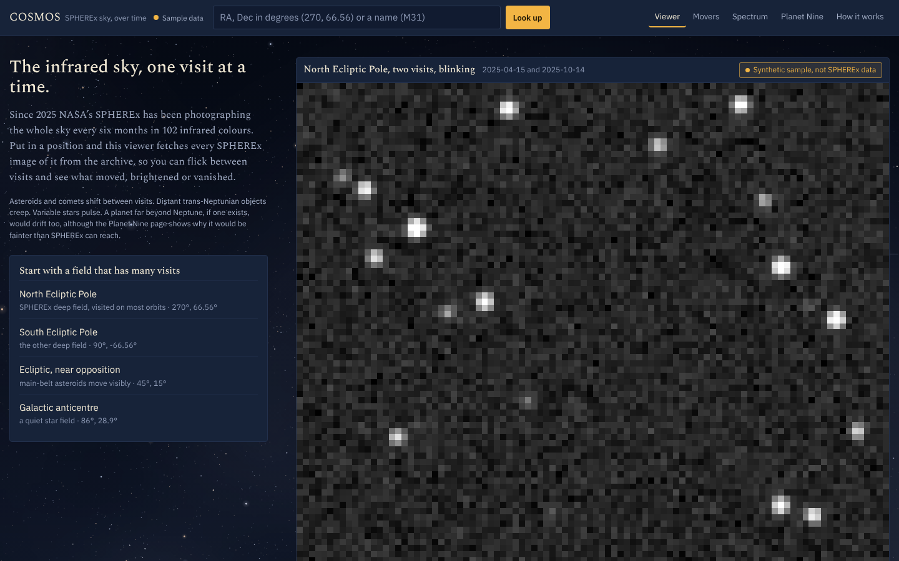
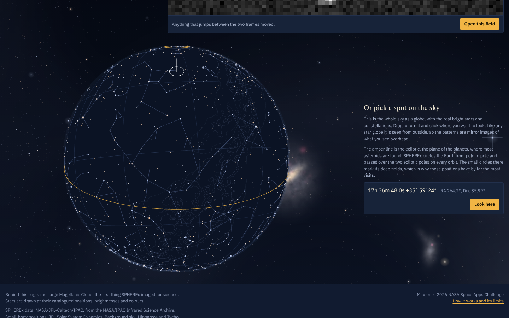
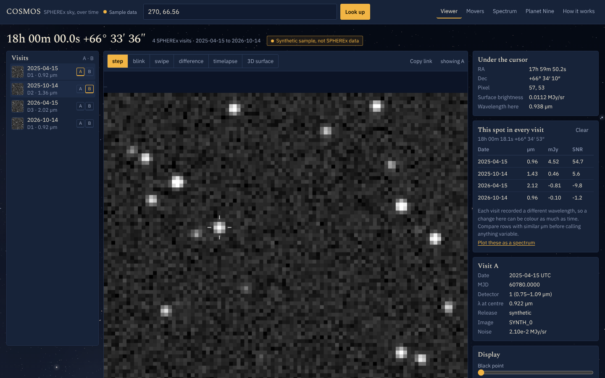
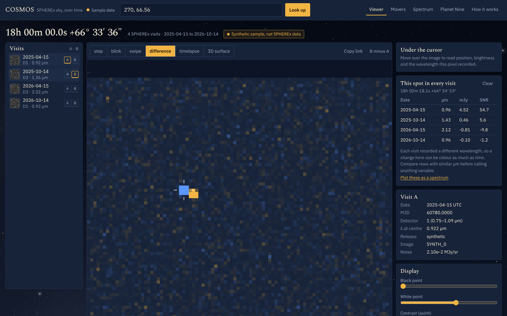
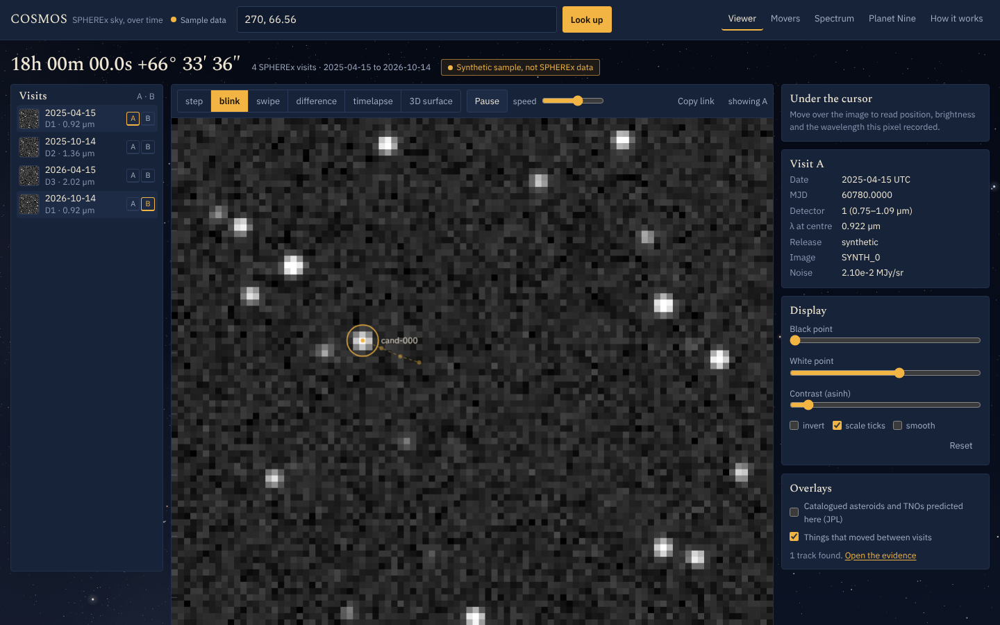
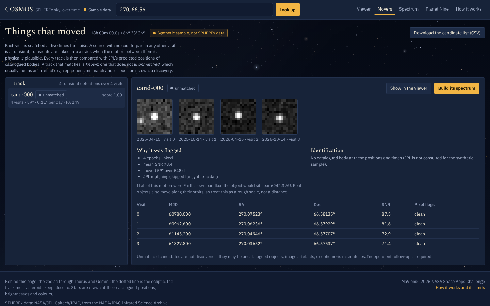
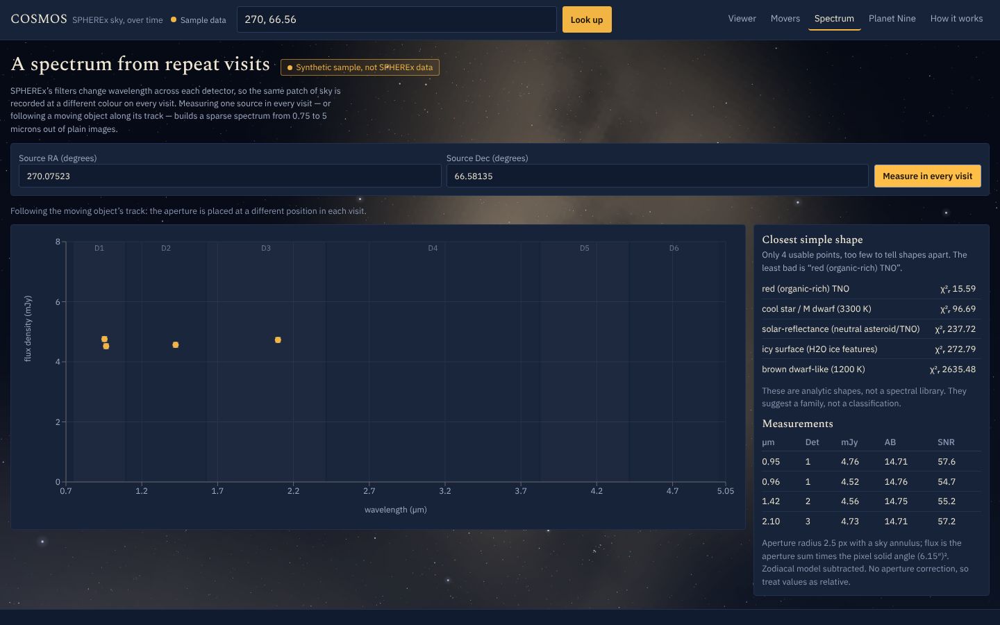
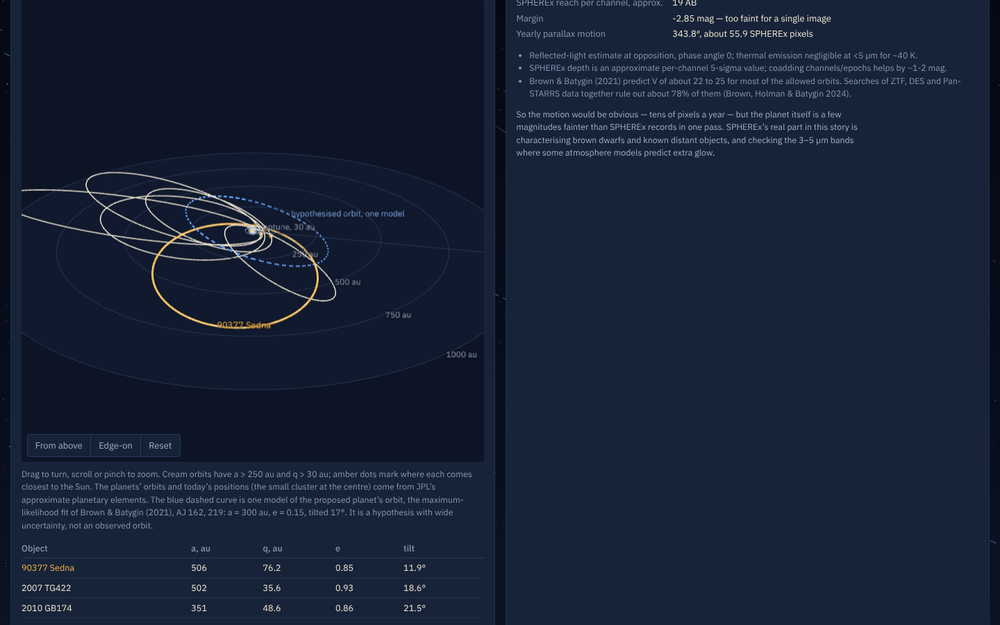
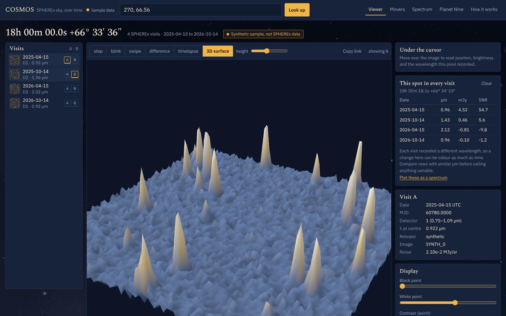
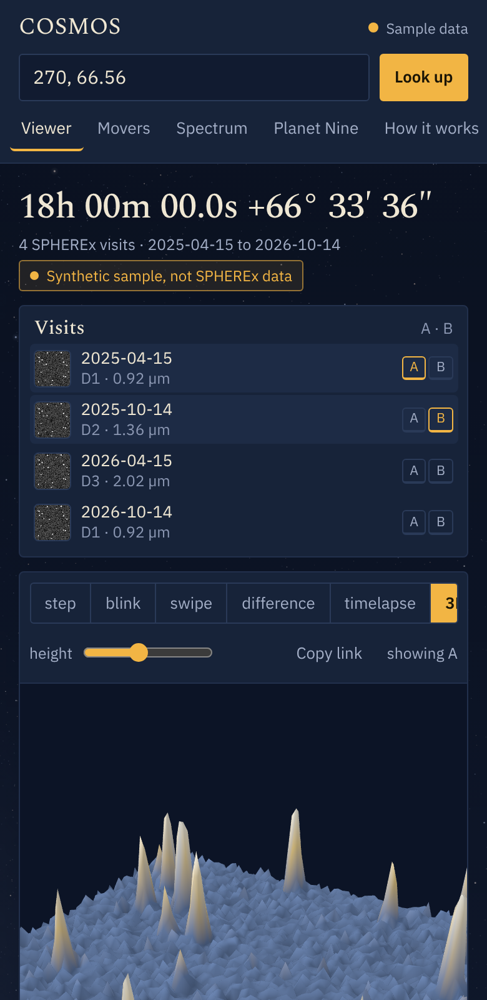

<div align="center">

# COSMOS: SPHEREx sky, over time

**MaVionix · NASA Space Apps Challenge 2026 · Sonipat · Challenge: "Planet X and SPHEREx"**

*Explore the Universe. Decode Cosmic Mysteries.*


</div>

A public web viewer for NASA's SPHEREx infrared sky survey, built by MaVionix for the 2026 NASA
Space Apps Challenge, "Planet X and SPHEREx".

Type a sky position or an object's name. COSMOS finds every SPHEREx image of that spot in the
NASA/IPAC Infrared Science Archive (IRSA) and lets you blink, swipe or difference any two visits
to see what changed. It also finds things that moved, checks them against JPL's catalogue of known
bodies, builds a spectrum from repeat visits, and shows what SPHEREx can and cannot say about
Planet Nine.

> **Note:** you may directly download the zip file of this repository for ease.


> **Scientific-integrity statement. What this tool does not claim.** It has not found Planet X and
> says so on every page. A track that matches no catalogued body is labelled *unmatched*, never
> *new*. When the archive cannot be reached, the site shows a generated test field that is labelled
> "Synthetic sample, not SPHEREx data" on screen, in exported images and in the CSV. All
> screenshots in this README were taken in sample mode, so they carry that badge.

---

## Contents

1. [Why this exists](#why-this-exists)
2. [Screenshots](#screenshots)
3. [Quick start](#quick-start)
4. [Features, page by page](#features-page-by-page)
5. [Architecture](#architecture)
6. [API reference](#api-reference)
7. [Science and formulas](#science-and-formulas)
8. [Datasets and access methods](#datasets-and-access-methods)
9. [Market, users and ecosystem](#market-users-and-ecosystem)
10. [Settings](#settings)
11. [Deployment](#deployment)
12. [Tests and validation](#tests-and-validation)
13. [Demo script](#demo-script-3-minutes)
14. [Presentation outline and judging criteria](#presentation-outline-and-judging-criteria)
15. [Troubleshooting](#troubleshooting)
16. [Glossary](#glossary)
17. [Data and credits](#data-and-credits)
18. [Use of AI tools](#use-of-ai-tools)
19. [Known gaps and roadmap](#known-gaps-and-roadmap)
20. [Changelog](#changelog)
21. [Licence and team](#licence-and-team)

---

## Why this exists

NASA's brief asked for *"a public-facing web tool to display SPHEREx images and make it easy to see
how they change over time."* SPHEREx maps the whole sky about every six months in 102 infrared
colours (0.75 to 5 µm), which is far too much for one person to look at. Anything that moves
between visits is a Solar System object, and the search for a distant Planet X is, at heart, a
search for something that moves very slowly and is very faint.

COSMOS answers the brief literally (images over time) and then extends it in the brief's own
direction (things that move):

1. **See** every visit of any field and compare them.
2. **Find** sources that appear to move, and say honestly whether JPL already knows them.
3. **Decode** what they are made of, by turning SPHEREx's changing wavelength into a spectrum.
4. **Explain** what SPHEREx could and could not see of Planet Nine, with measured numbers.


---

## Screenshots

All captured at 1440×900 in sample mode.

| Start page | Sky globe |
|---|---|
|  |  |
| A blinking deep field behind the search box and the showcase fields. | Real bright stars, constellations, ecliptic and SPHEREx's deep fields. Turn it and click to choose a position. |

| Viewer: measure a source in every visit | Difference two visits |
|---|---|
|  |  |
| Click a star to see its brightness, wavelength and SNR in each visit. | Red is brighter in B, blue is brighter in A. A warning appears when the two wavelengths differ. |

| Detected movers on the image | Movers table with JPL match |
|---|---|
|  |  |
| Tracks and JPL-predicted known bodies drawn over the field. | Each track labelled *known* or *unmatched*, with the evidence. |

| Spectrum from repeat visits | Planet Nine in 3D |
|---|---|
|  |  |
| A sparse 0.75 to 5 µm spectrum with an indicative template comparison. | Real orbits of distant objects, the giant planets today, and one published Planet Nine model drawn as a hypothesis. |

| Image as a 3D surface | Phone layout |
|---|---|
|  |  |
| Brightness becomes height, so faint sources stand out. | Touch to pan, pinch to zoom, tables scroll in their own box. |

**Site map**


---

## Quick start

You need Python 3.11 or newer and Node.js 20 or newer.

| | macOS / Linux | Windows |
|---|---|---|
| Start with real data | `./run.sh` | `run.bat` |
| Start with the offline sample | `./run.sh demo` | `run.bat demo` |
| Check this computer can reach the archive | `./run.sh check` | `run.bat check` |

The first start installs everything and builds the site, which takes a few minutes. Then open
**http://localhost:3000**. Press Ctrl+C to stop.

`make run`, `make demo`, `make check`, `make test`, `make docker` and `make clean` do the same
things from the repository root.

With Docker instead: `docker compose up --build`, then open http://localhost:3000.
For the offline sample: `COSMOS_MODE=demo docker compose up --build`.

### Check live data first

```bash
./run.sh check        # Windows: run.bat check
# or, directly:
python backend/scripts/verify_irsa.py 270 66.56
```

This asks IRSA for images of the north ecliptic pole, downloads one cutout, reads every part of
it, and queries both JPL services. It prints `ALL LIVE CHECKS PASSED` or says exactly which step
failed and which URL to open in a browser.

> **The live path was developed from the archive's published documentation in an environment
> without access to IRSA or JPL, and has been tested only against a stand-in archive. Run this
> check before relying on, or presenting, real data.** If the release names have changed, set
> `COSMOS_SPHEREX_COLLECTIONS` in `backend/.env`.

The dot beside the site name shows the result at a glance: "Archive online" or "Sample data".

### Manual start, for development

```bash
# terminal 1: API on http://localhost:8000 (interactive docs at /docs)
cd backend
python -m venv .venv && source .venv/bin/activate     # Windows: .venv\Scripts\activate
pip install -r requirements.txt
uvicorn app.main:app --reload --port 8000             # add COSMOS_MODE=demo for the sample

# terminal 2: website on http://localhost:3000
cd frontend
npm install
npm run dev
```

The website forwards `/api/*` to the API, so there is nothing to configure when both run on one
machine. To point it elsewhere, set `COSMOS_API_URL` (see `frontend/.env.example`). If you prefer
the browser to call the API directly, set `NEXT_PUBLIC_API_URL=http://localhost:8000` in
`frontend/.env.local` and make sure `COSMOS_CORS_ORIGINS` on the API includes the site address.

### Live mode and the labelled fallback

In `live` mode the API falls back to the labelled synthetic sample **only** if IRSA returns
nothing and `COSMOS_ALLOW_SYNTHETIC_FALLBACK=true` (the default). Set it to `false`, for example
when judging, if you would rather get a hard error than sample data.

---

## Features, page by page

| Page | What you can do |
|---|---|
| **Start page** | A blinking deep field, and a 3D globe of the whole sky (real bright stars, constellations, ecliptic, SPHEREx's deep fields) that you turn and click to choose a position. |
| **Viewer** | See every visit of a field. Step, blink, swipe or difference two visits, play all visits as a timelapse, or view the image as a 3D surface with brightness as height. Click a star to measure it in every visit. Zoom and pan with mouse, touch or keyboard. Read RA/Dec, surface brightness and the wavelength recorded at the cursor. Overlay JPL-predicted known bodies and detected movers. Copy a link to the exact view. Save the view as a captioned PNG. |
| **Movers** | 5σ source extraction per visit, then cross-visit linking, then a JPL SBIdent match. Sources found in one visit and not the others are linked into tracks, each compared with JPL's predictions and labelled *known* or *unmatched* with the evidence. Evidence cards and a CSV download. |
| **Spectrum** | Forced aperture photometry of one source (or along a track) in every visit, giving a sparse 0.75 to 5 µm spectrum, with an indicative comparison against five simple shapes. |
| **Planet Nine** | The outer Solar System in 3D: orbits of the most distant known objects with their real tilts, the giant planets at today's positions from JPL's planetary elements, and one published model of the proposed orbit drawn as a hypothesis. Also a reflected-light brightness calculator and a measured completeness curve for the current field. |
| **How it works** | Data sources, each processing step, limits, privacy, and how the site was built. |

### Viewer modes

| Key | Mode | What it shows |
|---|---|---|
| `1` | step | One visit at a time. |
| `2` | blink | Alternates visit A and B. Stars stay put, noise changes, movers jump. |
| `3` | swipe | A slider reveals B over A. |
| `4` | difference | Noise-scaled B minus A on a red/blue ramp. |
| `5` | timelapse | Every visit in date order. |
| `6` | 3D surface | Brightness as height. |

**Keyboard in the viewer:** `←` `→` change visit A, `[` `]` change visit B, `space` plays or
pauses, `1` to `6` switch mode, `i` inverts, `+` `-` `0` zoom and fit.

**Under the cursor:** RA, Dec, pixel, surface brightness (MJy/sr) and the wavelength recorded at
that pixel. Each visit's panel lists date, MJD, detector, wavelength at centre, release, image ID
and noise.

**Share and export:** the address bar holds the field, visits A and B, mode and movers overlay, so
*Copy link* reproduces the exact view. *Save image* writes a captioned PNG that keeps the
"Synthetic sample" badge when sample data is in use.

**Background and accessibility.** The background of every page is the real sky (Hipparcos and
Tycho stars at their catalogued positions and colours), looking at a different region on each
page; the foot of the page says which. Blinking does not start by itself for people who ask their
system for reduced motion. The 3D views need WebGL; where it is missing the site shows the flat
equivalents.

---

## Architecture


```
frontend/   Next.js 16, React 19, TypeScript, Tailwind 4, Recharts, three.js
            src/components/SkyCanvas.tsx        canvas viewer: 16-bit pixels, asinh stretch, WCS readout
            src/components/SkyGlobe.tsx         3D sky globe for choosing a field
            src/components/Surface3D.tsx        image as a 3D surface
            src/components/OrbitScene3D.tsx     outer Solar System in 3D
            src/components/SpaceBackground.tsx  real-sky background, one region per page
            src/lib/orbits.ts                   JPL planetary elements, Kepler maths, Planet Nine reference
            src/lib/skyScene.ts                 which region of sky each page faces
            src/lib/three-stage.ts              shared three.js wrapper for all 3D views
            src/lib/wcs.ts                      gnomonic (TAN) projection maths
            src/app/api/[...path]/route.ts      same-origin proxy to the API
backend/    FastAPI, Astropy, photutils, NumPy, SciPy, httpx
            app/core/irsa.py                    IRSA image search and cutouts, cached on disk
            app/core/fits_tools.py              SPHEREx multi-extension FITS reader (defensive)
            app/core/render.py                  asinh stretch, WCS reprojection, difference imaging
            app/core/service.py                 field loading, parallel downloads, fallback rules
            app/science/movers.py               detection, linking, scoring, distance hint
            app/science/jpl.py                  SBIdent (known bodies) and SBDB (TNO elements)
            app/science/spectrum.py             forced photometry and templates
            app/science/detectability.py        Planet Nine brightness, injection-recovery
            app/data/synthetic.py               the labelled offline sample
            scripts/verify_irsa.py              live-data check used by `run.sh check`
tests/      e2e_smoke.py                        browser test of every page, desktop and phone
docs/       methods, datasets, architecture, testing, deployment, pitch, demo script
```

There is no database. Cutouts are cached on disk and JPL answers are cached as JSON.

### What the browser receives

Each frame ships its quantised 16-bit pixels (about 20 kB for a 100×100 cutout), a TAN WCS and a
16×16 wavelength grid. The canvas applies the stretch, draws blink, swipe and difference, and
computes RA/Dec and wavelength under the cursor with no further requests. A small PNG thumbnail is
included for lists.

### Why these choices

- **FastAPI and Astropy.** The SPHEREx MEF, the WCS-WAVE lookup table and reprojection are native
  to the Python astronomy stack, so there is no reimplementation risk.
- **Cutouts, not files.** A 70 MB MEF per detector per visit would make a live web tool unusable.
  IBE cutouts (about 100×100 px, under 1 MB) keep first load under a minute even for 20+ visits.
- **16-bit pixels and WCS to the browser.** Interaction needs no round trips.
- **No database by default.** Disk cache plus URL state are enough. An optional schema is below.
- **Classical detection.** DAOStarFinder, linking and ephemeris matching are explainable and need
  no labelled training set. A machine-learning real/bogus classifier is the natural next step.
- **Next.js App Router.** Static pages and URL-driven state give shareable links to a field and a
  candidate, with good enough SEO for a public tool.

### Request path and operations

```
browser ──► website (Next.js) ──/api/*──► API (FastAPI) ──► IRSA, JPL, CDS
            same origin           gzip, rate limit, request id, security headers
```

- The browser never calls the API host directly. `frontend/src/app/api/[...path]/route.ts`
  forwards the request and reads `COSMOS_API_URL` at run time, so one built image works on any host.
- `core/service.py` holds one lock per field, so two simultaneous requests for the same field cause
  one download. Cutouts are fetched four at a time and written to the disk cache atomically.
- Fields are kept in an in-process LRU of 16. Results from the archive stay in memory for six
  hours. A fallback to the sample that was caused by an outage is kept for 90 seconds only, so the
  site recovers on its own.
- The viewer keeps its state (field, visits A and B, mode, movers overlay) in the address bar.
- Every response carries an `X-Request-ID`, `X-Content-Type-Options: nosniff`,
  `Referrer-Policy: strict-origin-when-cross-origin` and `X-Frame-Options: DENY`.

### 3D views and backgrounds

- `lib/three-stage.ts` wraps three.js for all three 3D views: one renderer, orbit controls, labels
  that keep their pixel size, drawing only when something changed, and full clean-up on unmount.
  three.js is loaded with `next/dynamic` only when a 3D view opens.
- Every 3D view reports WebGL failure to its page, which then shows the flat equivalent.
- `SpaceBackground` is a 2D canvas that projects the star catalogue stereographically. The route
  and the viewer's resolved field select a scene from `lib/skyScene.ts`; the camera basis is
  interpolated to the new scene over 1.7 s (not at all under reduced motion).

### Optional PostgreSQL schema (persistence and curation)

```sql
CREATE TABLE field (
  id SERIAL PRIMARY KEY, ra DOUBLE PRECISION, dec DOUBLE PRECISION,
  size_arcsec REAL, source TEXT, created_at TIMESTAMPTZ DEFAULT now());
CREATE TABLE epoch (
  id SERIAL PRIMARY KEY, field_id INT REFERENCES field(id),
  obs_id TEXT, detector SMALLINT, collection TEXT, mjd DOUBLE PRECISION,
  access_url TEXT, lambda_centre_um REAL, noise_sigma REAL, is_synthetic BOOL);
CREATE TABLE candidate (
  id SERIAL PRIMARY KEY, field_id INT REFERENCES field(id), label TEXT,
  status TEXT CHECK (status IN ('unmatched','known','artefact')),
  jpl_name TEXT, rate_arcsec_day REAL, pa_deg REAL, score REAL,
  reasons JSONB, created_at TIMESTAMPTZ DEFAULT now());
CREATE TABLE detection (
  id SERIAL PRIMARY KEY, candidate_id INT REFERENCES candidate(id),
  epoch_id INT REFERENCES epoch(id), x REAL, y REAL,
  ra DOUBLE PRECISION, dec DOUBLE PRECISION, snr REAL, flagged BOOL);
CREATE INDEX ON field USING gist (point(ra, dec));   -- or PostGIS geography if preferred
```

Sky indexing can be done with HEALPix (`astropy_healpix`) rather than PostGIS; PostGIS is not
required for this workload.

### Performance notes

- First load of a field is dominated by IRSA (N cutouts × about 1 to 3 s). Cutouts are cached on
  disk; a warm field renders in under 1 s.
- `/api/movers` on 20 visits × 100×100 px takes under 2 s of CPU.
- Injection-recovery (9 magnitudes × 12 injections × detection) takes about 3 to 6 s;
  `n_per_mag` is capped at 40.
- To pre-warm a showcase field: `curl "$API/api/sky/epochs?ra=270&dec=66.56"`.

---

## API reference

Interactive documentation is served by the API at `/docs`. All data endpoints accept either
`target` (a name resolved by CDS Sesame) or `ra` and `dec` in degrees, and are rate-limited per
client (see `COSMOS_RATE_LIMIT_PER_MIN`).

| Endpoint | Purpose | Notable parameters |
|---|---|---|
| `GET /api/health` | Liveness check, returns `{"ok": true, "mode": "live"}`. Never rate-limited. | none |
| `GET /api/status` | Can the server reach IRSA and JPL right now? `"serving"` is `"spherex"` or `"synthetic"`. | none |
| `GET /api/showcase` | The curated fields shown on the start page. Cached for an hour. | none |
| `GET /api/sky/epochs` | Every SPHEREx visit covering a position: frame pixels, WCS, wavelength grid, metadata, warnings. | `target`, `ra`, `dec`, `size` (≤ 3000″), `synthetic` |
| `GET /api/sky/diff` | Reproject visit B onto A and return the noise-scaled difference, plus a wavelength-mismatch warning. | `a`, `b` (visit indices) |
| `GET /api/sky/known` | JPL SBIdent known bodies predicted in one visit, as pixel coordinates. | `epoch` |
| `GET /api/movers` | Run detection, linking, scoring and JPL matching. Returns evidence cards and a disclaimer. | `threshold` (3 to 20 σ) |
| `GET /api/spectrum` | Forced photometry at one source (or along a track) in every visit, plus the template comparison. | `ra_src`, `dec_src` |
| `GET /api/planetx/tnos` | Orbital elements of distant TNOs from JPL SBDB. | `a_min` (default 30 AU) |
| `GET /api/planetx/brightness` | Planet Nine reflected-light brightness and margin against survey depth. | `mass_earth` (7), `albedo` (0.4), `distance_au` (600), optional radius |
| `GET /api/planetx/injection` | Injection-recovery completeness curve on the current field. | `epoch`, `n_per_mag` (≤ 40), `synthetic` |
| `GET /api/report.csv` | The movers report as CSV, including the status column. | same as movers |

Every response about image data carries `is_synthetic`. A `400` is returned for missing or invalid
coordinates, and a `429` with `Retry-After` when the per-client limit is exceeded.

---

## Science and formulas

Every number the site shows traces to a documented data product and a stated algorithm, and every
claim carries its uncertainty. The full write-up is in [`docs/METHODOLOGY.md`](docs/METHODOLOGY.md).
This section collects every formula in one place.

### Constants used

| Symbol | Value | Meaning |
|---|---|---|
| $p_{\rm pix}$ | 6.15″ / pixel | SPHEREx pixel scale |
| $\Omega_{\rm pix}$ | $(6.15/206265)^2 \approx 8.89\times10^{-10}$ sr | Solid angle of one pixel |
| $F_0$ | 3631 Jy | AB-magnitude zero point |
| 206265 | arcsec per radian | Used in every angular conversion |
| $R_\oplus$ | 6371 km | Earth radius |
| FWHM | 1.6 px | Assumed PSF width for detection |
| $\varepsilon$ | 23.4392911° | Mean obliquity of the ecliptic at J2000 |

### 1. From position to visits

1. Resolve the input to ICRS RA/Dec (degrees, or a name through CDS Sesame).
2. SIAv2 cone search (radius = half the cutout width) against QR3, then DR1.
3. For each returned spectral image, request an IBE cutout (default 600″, about 98 px) so the
   service never moves 70 MB files. Cutouts keep IMAGE, FLAGS, VARIANCE, ZODI and WCS-WAVE.
4. Sort by MJD and cap at 40 visits (configurable). When more exist, they are sampled evenly in
   time.

### 2. SPHEREx wavelength coverage

SPHEREx uses **linear-variable filters**: the wavelength a pixel sees changes continuously across
each detector. Two visits to the same sky position therefore usually sample *different*
wavelengths. COSMOS treats this as a feature (spectra, section 6) and as a trap (differencing,
section 4).


| Detector | Band (µm) | Resolving power R |
|---|---|---|
| D1 | 0.75 – 1.09 | 39 |
| D2 | 1.10 – 1.62 | 41 |
| D3 | 1.63 – 2.41 | 41 |
| D4 | 2.42 – 3.82 | 35 |
| D5 | 3.83 – 4.41 | 112 |
| D6 | 4.42 – 5.00 | 128 |

Each pixel's wavelength is read from the `WCS-WAVE` extension. If that cannot be read, COSMOS falls
back to the detector band centre and sets `wavelength_source = "band-range-only"`, and the
interface says so. It never invents a value.

### 3. Background, noise and display

**Background.** Subtract the `ZODI` model extension (the dominant diffuse background at 1 to 5 µm),
then a robust median of unflagged pixels.

**Noise.** Where a `VARIANCE` extension exists:

$$\sigma = \sqrt{\mathrm{median}(\mathrm{VARIANCE})}$$

otherwise the median absolute deviation, scaled to a Gaussian-equivalent sigma:

$$\sigma = 1.4826 \times \mathrm{MAD}$$

**Display stretch.** Intensities are clipped between the 1st and 99.5th percentiles
($\ell$ and $h$), normalised, then passed through an inverse hyperbolic sine so faint structure
stays visible without saturating bright stars:

$$x = \mathrm{clip}\!\left(\frac{I-\ell}{h-\ell},\,0,\,1\right), \qquad
y = \frac{\operatorname{asinh}(x/a)}{\operatorname{asinh}(1/a)}, \quad a = 0.1$$

Images are upscaled 4× with nearest-neighbour only, so individual SPHEREx pixels stay visible and
no interpolation can invent structure.


### 4. Wavelength-aware difference imaging

1. Reproject visit B onto visit A's pixel grid using the full `astropy.wcs` transform (no
   small-angle shortcuts) with bilinear interpolation. Pixels outside B's footprint become `NaN`
   and are excluded.
2. Scale the difference by the quadrature sum of both noise estimates:

$$D = \frac{I_B - I_A}{\sqrt{\sigma_A^2 + \sigma_B^2}}$$

3. Render on a diverging ramp: **red = brighter in B, blue = brighter in A**. The ramp saturates at
   $\pm 5$ in these units.
4. Read each visit's central wavelength from `WCS-WAVE`. If

$$|\lambda_A - \lambda_B| > 0.25\ \mu\mathrm{m}$$

   the API returns a warning and the UI lists only the "clean" same-band pairs.


Without this check every star shows up in the difference image, because it is a different
brightness at each wavelength. The figure above is a toy illustration, not SPHEREx data.

### 5. Moving-object detection


| Step | Rule | Why |
|---|---|---|
| Detect | `photutils.DAOStarFinder`, FWHM 1.6 px, threshold $5\sigma$, border excluded | Standard and transparent. SPHEREx's PSF is about 1 to 2 px at 6.15″/px. |
| Flag check | Any non-zero `FLAGS` value in the 3×3 pixels around a detection marks it `flagged` | Hot pixels, saturation and cosmic rays are flagged upstream. |
| Reject static | A detection with a counterpart in any other visit within **9″** (1.5 px) is static | Stars and galaxies. |
| Link | Pairs of transients with separation $\ge 9''$ and rate $\le 400''$/day. Extend to further visits by linear prediction within **27″** | 400″/day covers main-belt rates (tens of ″/h) while rejecting detector-to-detector coincidences. |
| Score | See below | Simple, monotonic, shown beside the reasons. |
| Identify | JPL SBIdent, **30″** tolerance, all visits must agree on one name, then `known` | Geocentric observer: SPHEREx's 650 km orbit gives under 1″ of parallax beyond 1 AU. |


**Motion rate** of a track with total separation $s$ (arcsec) over $\Delta t$ (days):

$$\dot\theta = \frac{s}{\Delta t}\ \ [''/\mathrm{day}]$$

**Candidate score** ($n$ = number of linked visits, SNR capped at 20):

$$\mathrm{score} = \min\!\left(1,\ 0.3\,(n-1) + \frac{\min(\mathrm{SNR},\,20)}{40}\right)\times
\begin{cases} 0.6 & \text{if any flagged pixel} \\ 1 & \text{otherwise} \end{cases}$$

**Distance hint.** If the whole motion were reflex parallax, with Earth's baseline over $\Delta t$
days equal to

$$b = \left|\,2\sin\!\left(\frac{\pi\,\Delta t}{365.25}\right)\right|\ \mathrm{AU}$$

and total motion $\theta = \dot\theta\,\Delta t$, then

$$d \approx \frac{206265''\cdot b}{\theta}\ \ \mathrm{AU}$$


Real bodies also move on their own orbits, so this is an **order-of-magnitude indicator** and is
shown with that caveat.

**Output per candidate:** per-visit cutout thumbnails, positions, SNR, flags, motion vector, JPL
match, and a `reasons` list. The CSV report reproduces the UI, including the status column.

> **Unmatched is not discovered.** The disclaimer is returned by the API, shown in the UI and
> repeated in the CSV.

### 6. Spectral fingerprint from repeat visits

Because each visit samples a different wavelength, N visits of one source give N points of a
0.75 to 5 µm spectrum from imaging alone.

**Forced aperture photometry.** Circular aperture $r = 2.5$ px, sky annulus 4.5 to 7.5 px
(inner radius $r+2$, outer $r+5$). With $A_{\rm ap}$ the aperture area in pixels:

$$S_{\rm net} = \sum_{\rm ap} I \;-\; \bar I_{\rm sky}\,A_{\rm ap}\qquad[\mathrm{MJy/sr\cdot px}]$$

$$\sigma_S = \sigma\sqrt{A_{\rm ap}}, \qquad \mathrm{SNR} = \frac{S_{\rm net}}{\sigma_S}$$

**Flux density and AB magnitude:**

$$F_\nu\,[\mathrm{Jy}] = S_{\rm net}\times 10^{6}\times\Omega_{\rm pix}$$

$$m_{\rm AB} = -2.5\,\log_{10}\!\left(\frac{F_\nu}{3631\ \mathrm{Jy}}\right)$$

Each point's wavelength comes from `WCS-WAVE` at the aperture centre
(`wavelength_source = "wcs-wave"`), otherwise from the detector band centre
(`"band-range-only"`). The UI states which one it used.

**Template comparison.** Five analytic shapes $T_k(\lambda)$ are each normalised to a peak of 1
(see the right-hand panel of the figure in section 3):

| Template | Shape |
|---|---|
| Solar reflectance (neutral asteroid or TNO) | Planck function at 5772 K |
| Icy surface (H₂O ice features) | Solar continuum with Gaussian dips near 3.1, 2.0 and 1.5 µm |
| Red, organic-rich TNO | Solar continuum × $\lambda^{0.8}$ |
| Cool star / M dwarf | Planck function at 3300 K |
| Brown dwarf-like | Planck function at 1200 K |

Planck shape in frequency, $\nu = c/\lambda$:

$$B_\nu(T) \propto \frac{\nu^{3}}{e^{h\nu/k_BT}-1}$$

For each template the best-fit scale $s$ is a weighted least-squares solution, and templates are
ranked by reduced $\chi^2$:

$$s = \frac{\sum_i f_i\,T_i/e_i^{2}}{\sum_i T_i^{2}/e_i^{2}}, \qquad
\chi^2_{\rm red} = \frac{1}{N-1}\sum_i\left(\frac{f_i - s\,T_i}{e_i}\right)^{2}$$

At least 3 positive-flux points with wavelengths are required. The result is labelled
*indicative*: a real classification would use a spectral library and the ePSF.

### 7. Could SPHEREx see Planet Nine?


**Size.** When no radius is given, a simple mass-radius power law is used:

$$R = M^{0.5}\ R_\oplus, \qquad D = 2R\times 6371\ \mathrm{km}$$

**Absolute magnitude** (standard small-body relation, geometric albedo $p_V$):

$$H = 5\log_{10}\!\left(\frac{1329\ \mathrm{km}}{D\sqrt{p_V}}\right)$$

**Apparent magnitude** at heliocentric distance $r$ and geocentric distance $\Delta = r - 1$ AU,
at opposition (phase angle about 0):

$$V = H + 5\log_{10}(r\,\Delta), \qquad J_{\rm AB} \approx V + 0.1$$

The offset of 0.1 comes from solar colours: a neutral reflector has $V-J \approx +1.0$.

**Margin against survey depth** (`COSMOS_SURVEY_DEPTH_AB`, default 19.0, flagged "approximate" in
the UI):

$$\mathrm{margin} = m_{\rm depth} - J_{\rm AB}$$

**Motion would still be obvious.** Annual parallax amplitude and orbital motion at distance $d$ AU:

$$\varpi = \frac{206265''}{d}, \qquad
\varpi_{\rm px} = \frac{\varpi}{6.15''}, \qquad
\dot\theta_{\rm orb} \approx \frac{360\times3600''}{d^{3/2}}\ \ [''/\mathrm{yr}]$$

**Worked example** with the default inputs (7 M⊕, albedo 0.4, 600 AU):

| Quantity | Value |
|---|---|
| Radius $R$ | 2.65 R⊕ |
| Diameter $D$ | 33,712 km |
| $H$ | −6.03 |
| $V$ | 21.75 |
| $J_{\rm AB}$ | about 21.85 |
| Margin against depth 19.0 | **−2.85 mag** (about 3 mag too faint in one exposure) |
| Parallax amplitude | 343.8″ ≈ **55.9 pixels** per year |
| Orbital motion | about 88.2″ per year |

**What this says.** Planet Nine's brightness is below SPHEREx's single-exposure reach, yet its
motion would be easy to see if it were bright enough. The limit is brightness, not cadence. The
literature expects optical surveys such as Rubin/LSST to be the discovery instruments, and
SPHEREx to add context (3 to 5 µm constraints on bright infrared candidates). Brown & Batygin
(2021) predict V of about 22 to 25 for most allowed orbits, and searches of ZTF, DES and
Pan-STARRS data together rule out about 78% of them (Brown, Holman & Batygin 2024). Thermal
emission from a roughly 40 to 50 K body peaks near 60 to 70 µm, so SPHEREx's 0.75 to 5 µm bands
see essentially reflected light. Coadding channels or visits helps by about 1 to 2 mag, which does
not close a 3 mag gap on its own.

**Injection-recovery completeness.** To answer "what could we have seen *here*?", Gaussian-PSF
sources are injected into the real cutout at a grid of AB magnitudes and recovered with the same
detector (recovery counts if within 1.5 px). For each magnitude $m$:

$$F_\nu = 3631\ \mathrm{Jy}\times10^{-0.4\,m}, \qquad
A = \frac{F_\nu\times10^{-6}/\Omega_{\rm pix}}{2\pi\sigma_{\rm PSF}^{2}}, \qquad
\sigma_{\rm PSF} = \frac{\mathrm{FWHM}}{2.3548}$$

$$C(m) = \frac{N_{\rm recovered}}{N_{\rm injected}}$$

Default grid: 15, 16, 17, 18, 18.5, 19, 19.5, 20, 21 AB, with 12 injections each (up to 40). The
50% completeness depth is found by linear interpolation between the two grid points that bracket
$C = 0.5$:

$$m_{50} = m_a + \frac{C_a - 0.5}{C_a - C_b}\,(m_b - m_a)$$

### 8. Orbit geometry in the 3D views

Planet positions use NASA/JPL's "Approximate Positions of the Planets" (Table 1, valid 1800 to
2050). Each element $q$ is propagated from J2000 with its rate per Julian century,
$T = (\mathrm{JD} - 2451545.0)/36525$:

$$q(T) = q_0 + \dot q\,T, \qquad q \in \{a,\ e,\ I,\ L,\ \varpi,\ \Omega\}$$

with argument of perihelion $\omega = \varpi - \Omega$ and mean anomaly $M = L - \varpi$.
**Kepler's equation** is solved by Newton iteration (at most 12 steps, tolerance $10^{-10}$):

$$M = E - e\sin E, \qquad E_{k+1} = E_k + \frac{M - (E_k - e\sin E_k)}{1 - e\cos E_k}$$

True anomaly and orbital radius:

$$\nu = 2\arctan\!\left(\sqrt{\frac{1+e}{1-e}}\,\tan\frac{E}{2}\right), \qquad
r = \frac{a\,(1-e^{2})}{1 + e\cos\nu}$$

Ecliptic coordinates rotate into equatorial RA/Dec with the J2000 obliquity $\varepsilon$:

$$y_{\rm eq} = y\cos\varepsilon - z\sin\varepsilon, \qquad
z_{\rm eq} = y\sin\varepsilon + z\cos\varepsilon$$

$$\alpha = \operatorname{atan2}(y_{\rm eq},\,x), \qquad \delta = \operatorname{asin}\!\left(\frac{z_{\rm eq}}{r}\right)$$


The figure above is computed with exactly these formulas and the elements bundled in
`frontend/src/lib/orbits.ts`, for 2026-11-16. The dashed orbit is a *hypothesis*: the
maximum-likelihood model of Brown & Batygin (2021), AJ 162, 219 (a = 300 AU, e = 0.15, i = 17°,
Ω = 108°, ϖ = 254°), labelled as such on the site.

### 9. Uncertainties and limits

- **Astrometry:** WCS from the product, no refit. Expected at about the 1″ level, far below the
  6.15″ pixel.
- **Photometry:** no aperture correction (the ePSF extension would allow one), so fluxes are of
  relative quality.
- **Linking:** linear motion only. Cadence away from the poles is about 6 months.
- **Depth:** the survey depth constant is approximate and labelled so.
- **Classification:** no machine-learning real/bogus filter yet.

---

## Datasets and access methods

All data used by COSMOS are public NASA, JPL or IPAC products. Nothing is simulated except the
clearly labelled offline sample.

### 1. SPHEREx spectral images (primary)

| Item | Value |
|---|---|
| Mission | SPHEREx, a NASA Astrophysics Medium Explorer launched March 2025. All-sky 0.75 to 5.0 µm spectrophotometric survey, about 6-month cadence, 102 spectral channels across 6 detectors. |
| Products used | **Quick Release 3 (QR3)**, the current weekly quick release (from September 2026). **Data Release 1 (DR1)**, a reprocessing of all QR2-era images (November 2026). Together they form a uniformly processed set. QR1 and QR2 are retired or superseded and not used. |
| Level | Level-2 calibrated spectral images, one multi-extension FITS (MEF) per detector per pointing, 2040×2040 px, 6.15″/px, about 70 MB each. |
| Extensions | `IMAGE` (MJy/sr, zodi not subtracted), `FLAGS` (bitmap), `VARIANCE` ((MJy/sr)²), `ZODI` (model, MJy/sr), `EPSF`/`PSF`, `WCS-WAVE` (pixel to central wavelength and bandwidth). |
| Archive | NASA/IPAC Infrared Science Archive (IRSA), https://irsa.ipac.caltech.edu/Missions/spherex.html |
| Programmatic access | **SIAv2:** `https://irsa.ipac.caltech.edu/SIA?COLLECTION=<spherex_qr3\|spherex_dr1>&POS=circle <ra> <dec> <r>` returns a VOTable with `access_url`, `t_min`, `em_min`/`em_max`. **IBE cutouts:** append `?center=<ra>,<dec>&size=<N>arcsec` to the file URL for a trimmed MEF with the same HDUs. **astroquery:** `astroquery.ipac.irsa.Irsa.query_sia(pos=..., collection=...)`. **AWS Open Data:** `s3://nasa-irsa-spherex/` (no account needed). |
| Documentation | Explanatory Supplement (SSDC-DP-017); Archive User Guide https://caltech-ipac.github.io/spherex-archive-documentation/ ; tutorials: spherex-intro, spherex-cutouts, spherex-psf, spherex-source-discovery-tool, spherex-mosaic. |
| DOIs | QR3 10.26131/IRSA662, DR1 spectral images 10.26131/IRSA678, DR1 all-sky cube 10.26131/IRSA679. |
| Known issues | A PSF-extension header error in products released before 31 March 2026 (fixed in QR3 and DR1). `WCS-WAVE` is a lookup-table WCS that many readers do not support; COSMOS reads it defensively and falls back to the detector band range with an explicit `wavelength_source` flag. |

**Collection-name caveat.** The SIA collection identifiers are configured in
`COSMOS_SPHEREX_COLLECTIONS`. Run `python backend/scripts/verify_irsa.py` once on a connected
machine; if IRSA renamed a collection, the script prints the browser URL to check and you change
one environment variable.

### 2. JPL Solar System Dynamics

| API | Use in COSMOS | Endpoint |
|---|---|---|
| SBIdent | Which known asteroids, comets and TNOs are predicted inside a field at a given time, which labels tracks *known* or *unmatched* | `https://ssd-api.jpl.nasa.gov/sbident.api` (observer MPC 500 = geocentre, adequate for 6″ pixels except for very near-Earth objects) |
| SBDB Query | Osculating orbital elements for all TNOs with a above a limit, for the Planet Nine orbit plot | `https://ssd-api.jpl.nasa.gov/sbdb_query.api?sb-class=TNO&fields=full_name,a,e,i,om,w,q,...` |
| Approximate planet positions | Planet orbits and today's positions in the 3D views | Table 1, bundled in `frontend/src/lib/orbits.ts`, so it needs no network |

### 3. Name resolution

CDS Sesame through `astropy.coordinates.get_icrs_coordinates` (for example "Makemake" or "Vega").
For moving targets (comets, TNOs) a fixed name-to-position lookup is only valid at one time; use
RA/Dec instead.

### 4. Complementary data (documented for context, not integrated)

- NEOWISE and AllWISE 3.4 and 4.6 µm images (IRSA): a longer time baseline for slow movers.
- Pan-STARRS DR2, ZTF, DES: the optical surveys that already exclude about 78% of the Brown &
  Batygin (2021) Planet Nine parameter space (Brown, Holman & Batygin 2024).
- Planck CMB maps: only relevant if a cosmology page is added; not SPHEREx data.

### 5. Synthetic demo data

`backend/app/data/synthetic.py` generates MEFs with the documented HDU layout and a known injected
mover. The primary header carries `SYNTHETC=True`; every API response carries `is_synthetic` and
the UI shows a persistent badge. It is used only when `COSMOS_MODE=demo`, or when live data are
unavailable and fallback is enabled.

### 6. Background night sky (cosmetic, real data)

| Layer | Data | Source |
|---|---|---|
| Stars (positions, V magnitude, B-V colour) | Hipparcos and Yale Bright Star catalogues, `stars.6.json` (to mag 6) and `stars.8.json` (to mag 8) | d3-celestial 0.7.35 (BSD-3, O. Frohn) |
| Milky Way | Measured isophote outlines, `mw.json`, shaded with galactic structure (warm bulge, Great Rift dust lanes) | d3-celestial 0.7.35 |
| Large and Small Magellanic Clouds, 47 Tuc, NGC 362 | J2000 centres, angular sizes, position angles; HII regions (30 Doradus, N11/NGC 1763, N44, N159, N119, N70, NGC 346) at catalogue coordinates | Published values, hard-coded in `SpaceBackground.tsx`. The shading inside them is procedural. |

The LMC is there because SPHEREx's first science images were scans across the LMC and the
NGC 1763 region. Stars and the Milky Way are served from this site (`frontend/public/data/sky/`)
in a compact form (about 380 kB compressed), so there are no third-party requests.

---

## Market, users and ecosystem

COSMOS is an open-source student project, not a commercial product. This section describes who it
serves and where it sits among existing tools. It contains no sales or market-size claims.

### Who it is for

| Audience | What they get |
|---|---|
| **Curious public and students** | A guided way to see how the infrared sky changes, with plain-language labels and a built-in lesson on why a null result still matters. |
| **Teachers and outreach teams** | A ready demo (sample mode needs no internet) and a shareable link to the exact view. |
| **Citizen-science projects** | Triage-ready evidence cards: thumbnails, SNR, flags, motion and a *known* / *unmatched* label. |
| **Amateur and professional astronomers** | A quick look at every visit of a field, a wavelength-aware difference image, per-source photometry and CSV export. |
| **SPHEREx and Solar System researchers** | An inspectable baseline for asteroid and TNO colours, ice features near 3 µm and brown-dwarf colours, plus a field-specific completeness curve. |

### Where it fits among existing tools

| Tool | What it does | Gap COSMOS fills |
|---|---|---|
| IRSA SPHEREx Data Explorer | Official browse, search and visualise of spectral images | Expert interface. No time-series blink or mover logic. |
| IRSA Spectrophotometry and Source Discovery tools | Forced photometry and source finding on one image | Not multi-epoch, not aimed at the public. |
| Other Space Apps blink-comparator projects | Position, then visits, then blink; some add SBIdent matching | Ignore the linear-variable-filter wavelength mismatch. No spectra. Planet X presented as marketing. |
| Zooniverse "Backyard Worlds" | Human flipbook classification of WISE movers | WISE only. No SPHEREx data and no spectra. |
| Brown & Batygin survey analyses | Research-grade Planet Nine exclusion | Not interactive, and uses optical data. |

### What makes it different

1. **Wavelength-aware differencing.** Every visit's wavelength is shown, mismatched pairs are
   warned about and clean same-band pairs are listed. On SPHEREx this is the difference between a
   difference image that shows movers and one that shows every star twice.
2. **Spectral fingerprint from time-domain data.** The linear-variable-filter "problem" becomes a
   feature: a source visited N times is sampled at N wavelengths, giving a partial 0.75 to 5 µm
   spectrum from imaging alone, which is unique to SPHEREx among all-sky surveys.
3. **Explainable, falsifiable detection.** Every candidate ships with its evidence (thumbnails,
   SNR, flags, motion, JPL match, reasons) and the CSV reproduces the UI. No black box, and no
   "AI found Planet X".
4. **Honest detectability, measured not quoted.** Injection-recovery on the *actual* cutout gives
   a field-specific completeness curve. The calculator shows why Planet Nine (V of about 22 to 25)
   is below SPHEREx's single-exposure reach even though its parallax would be tens of pixels.
   Teaching the public what a null result means is a contribution in itself.
5. **Public-first interface with research-grade provenance.** Coordinates, observation IDs, MJDs,
   collections, DOIs and acknowledgements are one click away on every screen, and shareable URLs
   encode the field.

### Scientific relevance

- Supports SPHEREx's own Solar System and Galactic science (asteroid and TNO colours, ice features
  at 3 µm, brown-dwarf colours) with a tool anyone can run.
- Provides a citizen-science-ready triage layer: known/unmatched labels plus evidence cards are
  what human classifiers need.
- Frames Planet X correctly: a hypothesis with quantified exclusion regions, for which SPHEREx
  contributes context, not discovery.

### How people can run or host it

| Path | Command or file | Notes |
|---|---|---|
| Local, one command | `./run.sh` or `run.bat` | Installs, builds and serves on port 3000. |
| Offline classroom or booth demo | `./run.sh demo` | Never touches the network. Everything is badged synthetic. |
| Docker on one machine | `docker compose up --build` | Web on 3000, API on 8000. |
| Render blueprint | `render.yaml` | Creates the API and the website services. |
| Vercel website, API elsewhere | see [Deployment](#deployment) | Docker service for the API on Render, Railway, Fly or a VM. |

---

## Settings

Backend settings are environment variables (prefix `COSMOS_`) or lines in `backend/.env`; see
`backend/.env.example`.

| Variable | Default | Meaning |
|---|---|---|
| `COSMOS_MODE` | `live` | `live` queries IRSA and JPL. `demo` never touches the network. |
| `COSMOS_ALLOW_SYNTHETIC_FALLBACK` | `true` | In live mode, show the labelled sample when the archive gives nothing. Set `false` to get an error instead. |
| `COSMOS_SPHEREX_COLLECTIONS` | `spherex_qr3,spherex_dr1` | IRSA release names, searched newest first. |
| `COSMOS_IRSA_SIA_URL` | `https://irsa.ipac.caltech.edu/SIA` | SIAv2 endpoint. |
| `COSMOS_CUTOUT_SIZE_ARCSEC` | `600` | Cutout width, about 98 SPHEREx pixels. |
| `COSMOS_MAX_EPOCHS` | `40` | Most visits loaded for one field. More are sampled evenly in time. |
| `COSMOS_SURVEY_DEPTH_AB` | `19.0` | Approximate per-channel 5σ depth used on the Planet Nine page. |
| `COSMOS_RATE_LIMIT_PER_MIN` | `120` | Requests per client per minute on data endpoints. `0` turns the limit off. |
| `COSMOS_CACHE_DIR` | `/tmp/cosmos-cache` | Where cutouts are cached. |
| `COSMOS_CORS_ORIGINS` | `http://localhost:3000` | Comma-separated. Only needed if the browser calls the API directly. |

Frontend settings: `COSMOS_API_URL` (run time, where the proxy forwards `/api/*`),
`NEXT_PUBLIC_API_URL` (only for bypassing the proxy) and `NEXT_PUBLIC_SITE_URL` (the public
address, for link previews).

Fixed in code (see `backend/app/config.py`): pixel scale 6.15″, detection threshold 5σ, JPL
SBIdent and SBDB URLs, observer MPC code 500 (geocentre), HTTP timeout 60 s.

---

## Deployment

The site is two services: the API (`backend/`, Python) and the website (`frontend/`, Node). The
website forwards `/api/*` to the API, so visitors only ever talk to one address and no CORS setup
is needed. The website finds the API through one runtime setting, `COSMOS_API_URL`.

Whatever host you use, do these three things after the first deploy:

1. Open `https://<your-site>/api/status`. `"serving": "spherex"` means the server can reach IRSA.
   `"serving": "synthetic"` means it cannot, and visitors will see the labelled sample.
2. Open the north ecliptic pole field once so its cutouts are cached.
3. Set `NEXT_PUBLIC_SITE_URL` to the public address so link previews work, then rebuild the website.

### Option A: one machine with Docker (fastest for judging)

```bash
git clone <your-repository> && cd mavionix-cosmos
cp backend/.env.example backend/.env           # edit if needed
docker compose up --build -d
# web: http://<host>:3000   api docs: http://<host>:8000/docs
```

Put a reverse proxy with HTTPS (Caddy, nginx, or a tunnel) in front of port 3000. Port 8000 does
not need to be public; remove its `ports` line in `docker-compose.yml` if you like.

Warm the cache for the showcase fields so the first visitor does not wait:

```bash
for f in "ra=270&dec=66.56" "ra=90&dec=-66.56" "ra=45&dec=15" "ra=86&dec=28.9"; do
  curl -s "http://localhost:3000/api/sky/epochs?$f" > /dev/null
done
```

### Option B: Render

`render.yaml` describes both services (`cosmos-api` and `cosmos-web`). In Render choose New, then
Blueprint, and pick the repository. This blueprint has not been run end to end by us, so check
both services after the first deploy: the website's `COSMOS_API_URL` should hold the API
service's internal address. Free instances sleep when idle, which makes the first request slow,
and have no persistent disk, so the cutout cache is lost on restart. Add a disk mounted at
`/cache` on a paid plan to keep it. One vCPU and 1 GB is enough.

### Option C: website on Vercel, API elsewhere

1. Deploy `backend/` as a Docker service on any host (Render, Railway, Fly, a VM), with a
   persistent volume at `/cache` if you want the cutout cache to survive restarts.
2. Import `frontend/` into Vercel and set `COSMOS_API_URL=https://<your-api-address>`.
3. Serverless functions have short time limits, and a field seen for the first time can take up to
   a minute. If first lookups time out, bypass the proxy: set
   `NEXT_PUBLIC_API_URL=https://<your-api-address>` on Vercel and
   `COSMOS_CORS_ORIGINS=https://<your-site-address>` on the API, then redeploy both.

### Option D: a stand with no internet

`./run.sh demo` or `COSMOS_MODE=demo docker compose up`. Every screen works and is labelled as
sample data.

To show real data without a connection, visit your fields while online with a persistent cache
directory, then go offline with `COSMOS_ALLOW_SYNTHETIC_FALLBACK=false`. Cached cutouts are
reused, but the list of visits is still requested from IRSA each time the server restarts, so keep
the server running between warming and showing. Uncached fields then fail loudly instead of
silently switching to synthetic data.

### Running it responsibly

- The API identifies itself to IRSA with a descriptive User-Agent (set in `core/irsa.py`),
  downloads at most four cutouts at a time, and caches every cutout on disk by URL, position and
  size. JPL orbit tables are cached for 24 hours.
- Each client is limited to 120 data requests a minute (`COSMOS_RATE_LIMIT_PER_MIN`). The limit is
  kept in memory per worker process; put a real rate limiter in your reverse proxy for a busy site.
- Behind a proxy, the API trusts `X-Forwarded-For` to tell clients apart. Do not expose port 8000
  directly to the internet in that setup.
- Clear old cutouts when the disk fills: `find /cache -name '*.fits' -mtime +14 -delete`.
- Logs carry a request id that is also returned in the `X-Request-ID` header, so a visitor's error
  report can be matched to a log line.
- Containers run as a non-root user.

---

## Tests and validation

```bash
cd backend && python -m pytest -q                         # 21 tests, no network needed
cd frontend && npm run typecheck && npm run lint && npm run build
./run.sh demo & python tests/e2e_smoke.py                 # browser test; needs playwright
```

GitHub Actions runs the backend and frontend checks on every push. The full report is in
[`docs/TESTING.md`](docs/TESTING.md).

### Backend tests (offline, reproducible)

| Test | What it proves |
|---|---|
| `test_mef_roundtrip_reads_all_documented_hdus` | The reader handles IMAGE, FLAGS, VARIANCE, ZODI and WCS-WAVE, detector and MJD headers, and the synthetic flag. |
| `test_wavelength_fallback_to_band_range` | A missing WCS-WAVE degrades to the band centre with an explicit `band-range-only` label. |
| `test_reprojection_is_identity_on_same_wcs` | WCS reprojection introduces under 1e-4 error on identity. |
| `test_stretch_outputs_uint8` | The display stretch is well-formed. |
| `test_mover_detection_recovers_injected_track` | A 3.2 px/visit injected mover is recovered as one 2+ visit track with a plausible rate, status `unmatched` (never "discovered"). |
| `test_no_movers_in_static_field` | Zero false tracks on a static star field with independent noise per visit. |
| `test_forced_photometry_and_classification` | Positive fluxes with `wcs-wave` wavelengths on a static star; the classifier returns a best template labelled *indicative*. |
| `test_planet_nine_is_too_faint_for_single_exposure` | Default Planet Nine parameters give V > 21 and `detectable = False`, with parallax above 30 px. |
| `test_injection_recovery_curve_is_monotone_ish` | Completeness at least 0.8 at 14 AB and at most 0.2 at 22 AB on synthetic data. |
| `test_api_health_and_showcase` | Service and showcase endpoints. |
| `test_api_epochs_are_labelled_synthetic_in_demo_mode` | Demo responses carry `source="synthetic"`, a SYNTHETIC warning, and per-frame flags. |
| `test_api_diff_movers_spectrum_report` | End to end: diff, then movers (with thumbnails and disclaimer), then spectrum along the track, then the CSV report. |
| `test_api_validation` | 400 on missing or invalid coordinates. |
| `test_status_and_headers_in_demo_mode` | `/api/status` reports sample mode; security headers and a request id are set. |
| `test_rate_limit_returns_429` | The per-client limit answers 429 with `Retry-After`; health checks are never limited. |

### The live code path against a stand-in archive (`tests/test_live_path.py`)

These replace the HTTP transport with a fake that answers as IRSA's documentation describes: a
VOTable from the image search and a FITS cutout from each access URL. They prove the plumbing, not
that the real archive agrees; only `scripts/verify_irsa.py` can show that.

| Test | What it proves |
|---|---|
| `test_live_field_is_labelled_irsa_and_time_ordered` | Two releases are queried, six cutouts fetched in parallel, visits come back in time order labelled `irsa`, and a repeat call downloads nothing. |
| `test_one_failing_release_is_skipped_with_a_warning` | A release that answers HTTP 500 is left out with a visible warning; the other still loads. |
| `test_outage_falls_back_then_recovers` | With the archive down the labelled sample is served; once it is back, real data is served again. |
| `test_fallback_is_cached_only_briefly` | An outage fallback is cached for at most 90 seconds. |
| `test_outage_without_fallback_fails_loudly` | With fallback turned off, an outage is an error, not sample data. |
| `test_non_fits_answer_is_rejected` | An HTML maintenance page in place of a cutout is refused and not cached. |

### Frontend

`npm run typecheck`, `npm run lint` and `npm run build` pass with no errors or warnings. Two lint
rules are switched off with reasons in `eslint.config.mjs`.

### Browser smoke test (`tests/e2e_smoke.py`)

Run against sample mode at 1440×900 and at 390×800 with touch. On each it checks: the landing page
and its archive status; the viewer's provenance badge; that mode, visits and the movers overlay
are written to the link; arrow-key control; the PNG export; the Movers page and the step from a
track to its spectrum; the Planet Nine page; the methods page; the 404 page; a readable error for
impossible coordinates; no sideways scrolling on any page; and no page errors. It also clicks the
3D globe to choose a position, opens the 3D surface view, checks the timelapse advances, clicks
the image to measure a source in every visit, checks the 3D orbit view and its flat alternative,
and checks that the background caption changes between pages. WebGL runs in software (SwiftShader)
in this test. **Result on the last run: 44 of 44 checks passed.** Defects this test has caught and
that are now fixed: the movers checkbox not responding while a search ran, and the header
overflowing on phones.

### Live validation checklist (run on a connected machine)

1. `./run.sh check`: all five checks pass and the header dot reads "Archive online". Note the
   number of visits at the North Ecliptic Pole (expect many).
2. Viewer, NEP field: blink two same-band visits. Stars must be static, the noise pattern must
   change.
3. Difference of a *different-band* pair must show the wavelength-mismatch warning.
4. Movers page on an ecliptic field near opposition: at least one `known` track (main-belt
   asteroid) with the JPL name and mean separation under 15″.
5. Movers page on a high-|β|, high-|b| field: zero or only low-score candidates.
6. Spectrum of a bright static star: at least 6 points spanning at least 3 detectors; a cool-star
   template preferred.
7. Injection-recovery on a real NEP cutout: 50% depth within about 0.5 mag of the configured
   survey depth.
8. Planet Nine page: the orbit panel shows no "JPL unreachable" notice, and the a > 250 AU,
   q > 30 AU perihelia cluster on one side.

Record results in `docs/TESTING.md` before submission (date, field, outcome, screenshot path).

---

## Demo script (3 minutes)

**Before you start:** API and web running; showcase fields pre-warmed; browser at `/`. Decide in
advance whether you are on real data or the sample (amber badge) and say it.

| Time | Step | What to say and show |
|---|---|---|
| 0:00 | **Hook** | "SPHEREx photographs the entire sky every six months in 102 infrared colours. Anything that moves between those photographs is a Solar System object. Nobody can look at a billion sources by hand, so we built a time machine for the sky." |
| 0:20 | **Viewer** | Click *North Ecliptic Pole*. "Every SPHEREx image of this spot, pulled live from NASA's archive as cutouts. Here is the date, the detector, and, unique to SPHEREx, the exact wavelength this pixel saw." Switch to *blink*: "Stars stay; noise changes." Switch to *difference* and point at the warning: "Two visits usually see different colours, so we only difference clean pairs; most blink tools get this wrong." |
| 1:00 | **Movers** | Turn on the movers overlay, or switch to the asteroid-rich field. "Five-sigma detection in every visit, link what disappears and reappears, check JPL's ephemerides." Open the top candidate: "Postage stamps, the motion vector, signal-to-noise, pixel flags, and the verdict: *known*, it is asteroid X. If it were *unmatched* we would say exactly that. Unmatched is not discovered." |
| 1:45 | **Spectrum** | Click *Build its spectrum*. "Because the wavelength drifts across the detector, every revisit sampled a different colour. Stack them and you get a spectrum from imaging alone. Here it sits closest to a solar-reflectance template: indicative, not a classification." |
| 2:15 | **Planet Nine** | "These are real orbits of the most distant known objects from JPL; their closest-approach points bunch up on one side, which is the whole argument. A seven-Earth-mass planet at 600 AU is about magnitude 22. SPHEREx reaches about 19. Its motion would be some sixty pixels a year, obvious, but it is three magnitudes too faint. That is why Rubin would find it, if it exists, and why we never claim SPHEREx has." Click *Measure completeness on the current field* to show the curve. |
| 2:50 | **Close** | "Real data, honest labels, evidence you can download. MaVionix COSMOS: explore the universe, decode cosmic mysteries." |

**Fallbacks.** If IRSA is slow, use a pre-warmed field. If offline, start with `./run.sh demo` and
say so out loud; the amber badge is on screen anyway.

---

## Presentation outline and judging criteria

**Seven slides, about four minutes**

1. **The challenge, in NASA's words.** SPHEREx: all sky, every 6 months, 102 bands, a billion
   objects, too much for one person.
2. **Our answer: the SPHEREx Viewer.** One screenshot: a field blinking, a mover circled, its
   spectrum beside it. *Explore the Universe. Decode Cosmic Mysteries.*
3. **Live demo (2 minutes).** Showcase field, then step/blink/difference, then the Movers page, a
   candidate labelled *known*, the spectral fingerprint, the Planet X calculator.
4. **What makes it different.** Wavelength-aware differencing, spectra from time-domain imaging,
   explainable evidence cards with JPL identification, measured completeness. Comparison table
   against existing tools.
5. **Scientific honesty.** Real-data badge versus synthetic badge; unmatched is not discovered;
   why SPHEREx cannot see Planet Nine at predicted brightness (V of about 22 to 25 against a depth
   of about 19) but would see its motion (about 56 px/yr of parallax at 600 AU).
6. **How it is built.** FastAPI, Astropy and photutils; Next.js and Tailwind; IRSA SIA and
   cutouts; JPL SBIdent and SBDB; Docker; offline tests; open source.
7. **Impact and next steps.** Citizen-science triage layer; MPC-format export; real/bogus
   machine learning with a stated false-positive rate; Zooniverse integration. Team MaVionix,
   Sonipat.

**Judging criteria mapping**

| Criterion | How COSMOS answers it |
|---|---|
| Impact | A public tool over a flagship NASA dataset that teaches what a null result means. |
| Creativity | Turning the linear-variable-filter wavelength drift into a spectroscopy feature. |
| Validity | Documented products, DOIs, acknowledgements, stated uncertainties and tests. |
| Relevance | Answers the brief literally (images over time) and extends it in the brief's own direction (things that move). |
| Presentation | One coherent product, not six modules. |

---

## Troubleshooting

| Symptom | Likely cause and fix |
|---|---|
| Header dot says "Sample data" and the badge says "Synthetic sample" | The server cannot reach IRSA, or you started in demo mode. Run `./run.sh check`, then see `https://<site>/api/status`. |
| `./run.sh check` fails on the image search | IRSA may have renamed a release. Open the URL the script prints and set `COSMOS_SPHEREX_COLLECTIONS` in `backend/.env`. |
| Planet Nine page shows "JPL unreachable" | SBDB could not be reached. The planets and the proposed orbit still work because they are bundled; retry when online. |
| First lookup of a field is slow | Cutouts are downloaded on first use (about 1 to 3 s each, four at a time). Warm the cache for your showcase fields, or keep a persistent `COSMOS_CACHE_DIR`. |
| 3D views are replaced by flat ones | WebGL is unavailable in the browser. The flat equivalents carry the same information. |
| `429 Too Many Requests` | The per-client limit was hit. Wait for `Retry-After`, or raise `COSMOS_RATE_LIMIT_PER_MIN`. |
| Browser shows a CORS error when calling the API directly | Add the site address to `COSMOS_CORS_ORIGINS`, or use the default same-origin proxy. |
| Lookups time out on Vercel | Serverless time limits. Bypass the proxy with `NEXT_PUBLIC_API_URL` and set `COSMOS_CORS_ORIGINS` (see Deployment, option C). |
| Backend will not start with `<<<<<<<` or `>>>>>>>` in the traceback | A git merge left conflict markers in a file. Resolve them (keep one side), then restart. |

---

## Glossary

| Term | Meaning |
|---|---|
| **SPHEREx** | Spectro-Photometer for the History of the Universe, Epoch of Reionization and Ices Explorer, NASA's all-sky infrared survey mission. |
| **IRSA** | NASA/IPAC Infrared Science Archive, which hosts SPHEREx data. |
| **SIA / SIAv2** | Simple Image Access, a standard way to search an archive for images by position. |
| **IBE cutout** | A server-side crop of a large FITS file, so only a small region is downloaded. |
| **MEF** | Multi-extension FITS: one file holding several image layers (IMAGE, FLAGS, VARIANCE, ZODI, WCS-WAVE). |
| **WCS** | World Coordinate System, the mapping from pixel to sky position (and here, to wavelength). |
| **LVF** | Linear-variable filter: a filter whose wavelength changes steadily across the detector. |
| **MJD** | Modified Julian Date, a day count used for observation times. |
| **MJy/sr** | Mega-Jansky per steradian, the unit of surface brightness in SPHEREx images. |
| **AB magnitude** | A brightness scale tied to flux density, zero at 3631 Jy. |
| **ZODI** | Zodiacal light, sunlight scattered by interplanetary dust, the main diffuse background in the infrared. |
| **TNO** | Trans-Neptunian object, a small body orbiting beyond Neptune. |
| **SBIdent / SBDB** | JPL services that list known small bodies in a field, and their orbital elements. |
| **asinh stretch** | A display curve that is linear for faint signal and logarithmic for bright signal. |
| **Injection-recovery** | Adding fake sources of known brightness to real data and measuring how many the detector finds. |
| **Completeness** | The fraction of injected sources that are recovered, as a function of brightness. |
| **Unmatched** | A track that matches no catalogued body. It is a lead, never a discovery claim. |

---

## Data and credits

- **SPHEREx** spectral images: NASA/JPL-Caltech/IPAC, from the NASA/IPAC Infrared Science
  Archive. Quick Release 3, DOI 10.26131/IRSA662. Data Release 1, DOI 10.26131/IRSA678.
- **Small-body positions and orbits:** JPL Solar System Dynamics (SBIdent and Small-Body Database).
- **Planet orbits and positions:** JPL "Approximate Positions of the Planets", Table 1, bundled in
  `frontend/src/lib/orbits.ts`. This NASA/JPL dataset works with no network connection.
- **Proposed Planet Nine orbit:** Brown & Batygin (2021), AJ 162, 219. Shown as a hypothesis.
- **Object names:** CDS Sesame.
- **Background and globe stars, constellation figures and Milky Way:** Hipparcos and Tycho
  catalogues as packaged by d3-celestial (BSD-3-Clause, Olaf Frohn). Licence in
  `frontend/public/data/sky/`.

> "This product makes use of data from the Spectro-Photometer for the History of the Universe,
> Epoch of Reionization and Ices Explorer (SPHEREx), which is a joint project of the Jet Propulsion
> Laboratory and the California Institute of Technology, and is funded by NASA."

COSMOS is a student project. It is not affiliated with or endorsed by NASA, JPL or Caltech, and
uses no NASA logos or mission insignia.

---

## Use of AI tools

Code debugging were done with help from an AI assistant (Claude, by Anthropic), and
were reviewed and tested by the team mavionix. The application contains no AI-generated images, audio in the backgrounds(frontend) and 3D views are drawn by team in the browser from catalogue data, and the offline
sample field comes from a documented algorithm in `backend/app/data/synthetic.py`. There is no AI model inside the running application.

---

## Known gaps and roadmap

### Known gaps

- Live IRSA and JPL calls were written from the documented endpoints and have never been run
  against the real services: the build environment could not reach those hosts. The live
  validation checklist is therefore mandatory, and its results should be recorded before real data
  is presented.
- The browser test runs in Chromium only, with software WebGL. Safari, Firefox and real phone GPUs
  have not been checked.
- The orbit maths has no automated test; it was checked by hand against known values (Sedna's
  perihelion direction, Jupiter's heliocentric longitude for the build date).
- No load testing has been done. The rate limit is per process and in memory.
- No aperture corrections; photometry is of relative quality.
- Linking is linear; fast or curved tracks across more than 3 visits may fragment into several
  candidates.
- The survey depth constant is approximate.

### Roadmap

- A real/bogus classifier trained on injected sources (labels for free), with a reported
  false-positive rate.
- PSF photometry and aperture corrections from the ePSF extension.
- Orbit ranging (statistical ranging) on tracks with three or more visits, and MPC-format output
  for genuinely unmatched, high-score candidates.
- Zooniverse export of evidence cards.
- Optional PostgreSQL persistence for candidate curation (schema above).


## Licence and team

Code: MIT, see `LICENSE`. Data remain under their providers' terms.

**Team:** MaVionix ([mavionix.in](https://mavionix.in)), Sonipat local event, 2026 NASA
International Space Apps Challenge.
