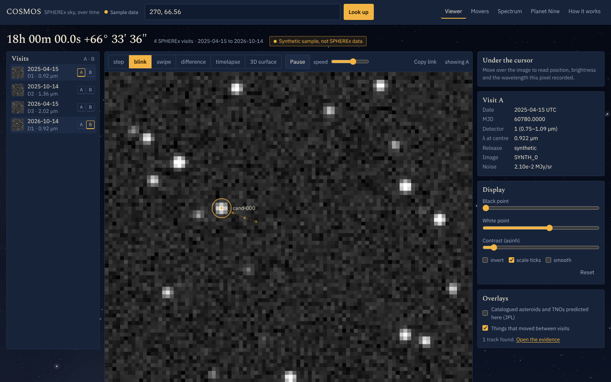
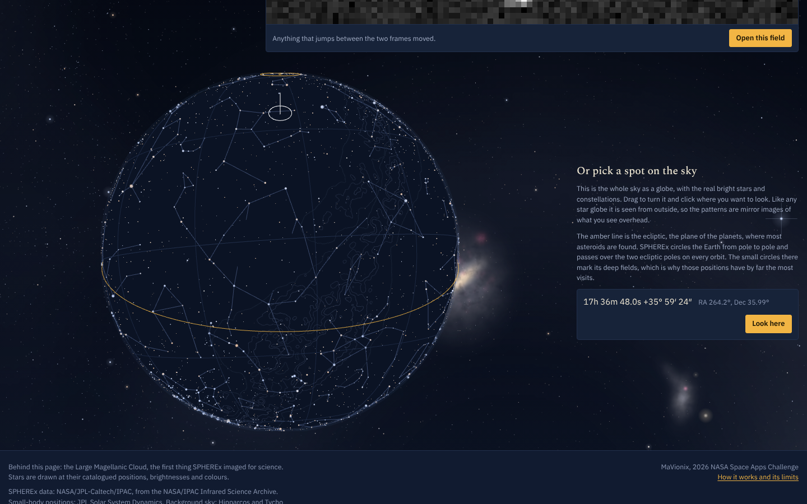
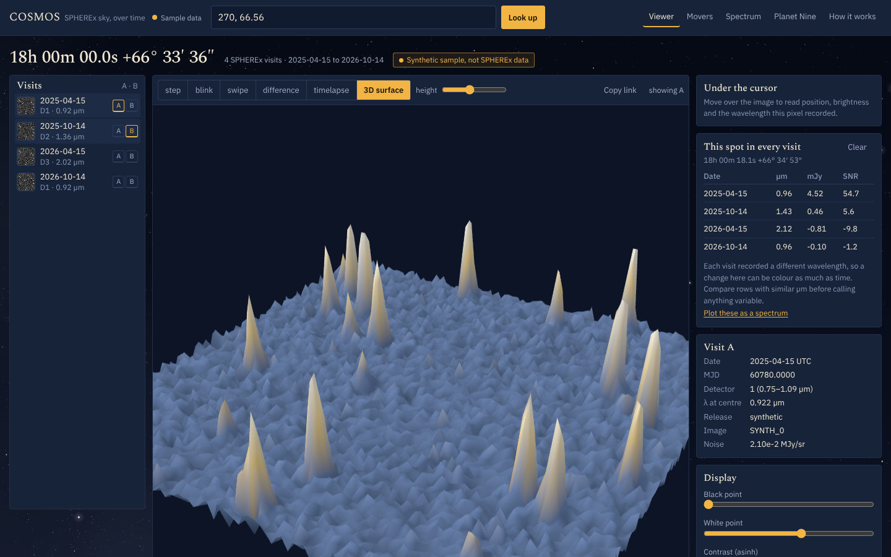
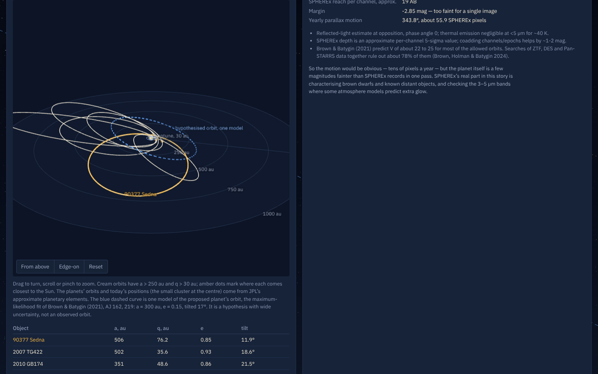
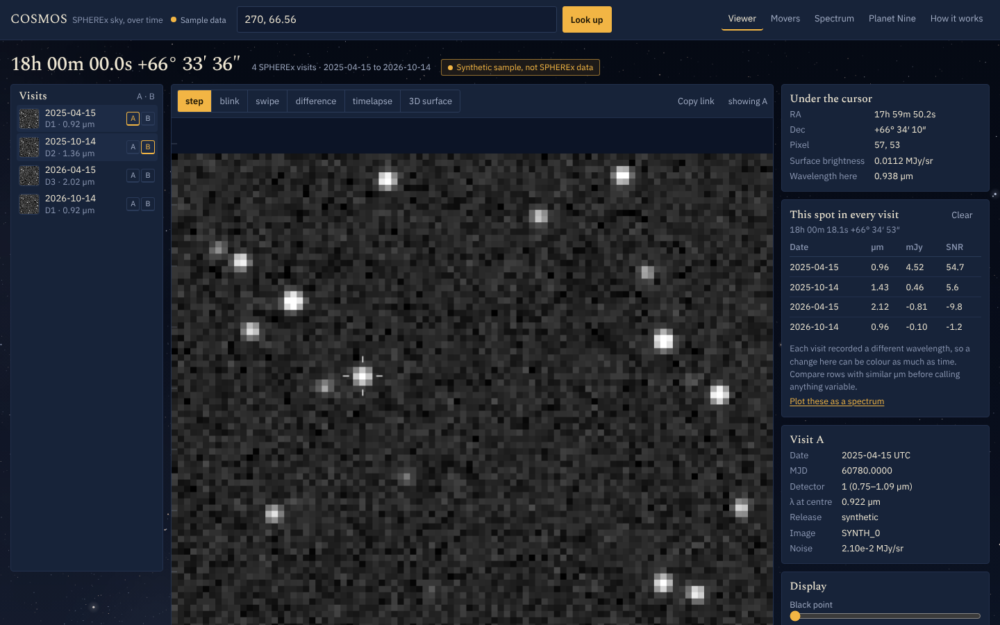

# COSMOS: SPHEREx sky, over time

A public web viewer for NASA's SPHEREx infrared sky survey, built by MaVionix for the 2026 NASA
Space Apps Challenge, "Planet X and SPHEREx". 

Type a sky position or an object's name. COSMOS finds every SPHEREx image of that spot in the
NASA/IPAC Infrared Science Archive (IRSA) and lets you blink, swipe or difference any two visits to
see what changed. It also finds things that moved, checks them against JPL's catalogue of known
bodies, builds a spectrum from repeat visits, and shows what SPHEREx can and cannot say about
Planet Nine.

Note: You May Direclty Download the zip file for ease.


| | |
|---|---|
|  |  |
|  |  |

All screenshots here were taken in sample mode, so they carry the "Synthetic sample" badge.

> **What this tool does not claim.** It has not found Planet X and says so on every page. A track
> that matches no catalogued body is labelled *unmatched*, never *new*. When the archive cannot be
> reached, the site shows a generated test field that is labelled "Synthetic sample, not SPHEREx
> data" on screen, in exported images and in the CSV.

## Run it

You need Python 3.11 or newer and Node.js 20 or newer.

| | macOS / Linux | Windows |
|---|---|---|
| Start with real data | `./run.sh` | `run.bat` |
| Start with the offline sample | `./run.sh demo` | `run.bat demo` |
| Check this computer can reach the archive | `./run.sh check` | `run.bat check` |

The first start installs everything and builds the site, which takes a few minutes. Then open
**http://localhost:3000**. Press Ctrl+C to stop.

With Docker instead: `docker compose up --build`, then open http://localhost:3000.
For the offline sample: `COSMOS_MODE=demo docker compose up --build`.

### Check live data first

```bash
./run.sh check        # Windows: run.bat check
```

This asks IRSA for images of the north ecliptic pole, downloads one cutout, reads every part of it,
and queries both JPL services. It prints `ALL LIVE CHECKS PASSED` or says exactly which step failed
and which URL to open in a browser. **The live path was developed from the archive's published
documentation in an environment without access to IRSA or JPL, and has been tested only against a
stand-in archive. Run this check before relying on, or presenting, real data.** If the release
names have changed, set `COSMOS_SPHEREX_COLLECTIONS` in `backend/.env`.

The dot beside the site name shows the result at a glance: "Archive online" or "Sample data".

### Manual start, for development

```bash
# terminal 1: API on http://localhost:8000 (interactive docs at /docs)
cd backend
python -m venv .venv && source .venv/bin/activate     # Windows: .venv\Scripts\activate
pip install -r requirements.txt
uvicorn app.main:app --reload --port 8000             # add COSMOS_MODE=demo for the sample

# terminal 2: website on http://localhost:3000
cd frontend
npm install
npm run dev
```

The website forwards `/api/*` to the API, so there is nothing to configure when both run on one
machine. To point it elsewhere, set `COSMOS_API_URL` (see `frontend/.env.example`).

## What is in it

| Page | What you can do |
|---|---|
| **Start page** | A blinking deep field, and a 3D globe of the whole sky (real bright stars, constellations, ecliptic, SPHEREx's deep fields) that you turn and click to choose a position. |
| **Viewer** | See every visit of a field. Step, blink, swipe or difference two visits, play all visits as a timelapse, or view the image as a 3D surface with brightness as height. Click a star to measure it in every visit. Zoom and pan with mouse, touch or keyboard. Read RA/Dec, surface brightness and the wavelength recorded at the cursor. Overlay JPL-predicted known bodies and detected movers. Copy a link to the exact view. Save the view as a captioned PNG. |
| **Movers** | Sources found in one visit and not the others, linked into tracks, each compared with JPL's predictions and labelled *known* or *unmatched* with the evidence. CSV download. |
| **Spectrum** | Aperture photometry of one source in every visit, giving a sparse 0.75 to 5 µm spectrum, with an indicative comparison against five simple shapes. |
| **Planet Nine** | The outer Solar System in 3D: orbits of the most distant known objects with their real tilts, the giant planets at today's positions from JPL's planetary elements, and one published model of the proposed orbit drawn as a hypothesis. Also a brightness calculator and a measured completeness curve for the current field. |
| **How it works** | Data sources, each processing step, limits, privacy, and how the site was built. |

Keyboard in the viewer: `←` `→` change visit A, `[` `]` change visit B, `space` plays or pauses,
`1` to `6` switch mode, `i` inverts, `+` `-` `0` zoom and fit.

The background of every page is the real sky (Hipparcos and Tycho stars at their catalogued
positions and colours), looking at a different region on each page. The foot of the page says
which. The 3D views need WebGL; where it is missing the site shows the flat equivalents.

## How it is put together

```
frontend/   Next.js 16, React 19, TypeScript, Tailwind 4, Recharts, three.js
            src/components/SkyCanvas.tsx     canvas viewer: 16-bit pixels, asinh stretch, WCS readout
            src/components/SkyGlobe.tsx      3D sky globe for choosing a field
            src/components/Surface3D.tsx     image as a 3D surface
            src/components/OrbitScene3D.tsx  outer Solar System in 3D
            src/components/SpaceBackground.tsx  real-sky background, one region per page
            src/lib/orbits.ts                JPL planetary elements, Kepler maths, Planet Nine reference
            src/lib/skyScene.ts              which region of sky each page faces
            src/app/api/[...path]/route.ts   same-origin proxy to the API
backend/    FastAPI, Astropy, photutils, NumPy, SciPy, httpx
            app/core/irsa.py                 IRSA image search and cutouts, cached on disk
            app/core/fits_tools.py           SPHEREx multi-extension FITS reader
            app/core/service.py              field loading, parallel downloads, fallback rules
            app/science/                     movers, JPL matching, spectra, detectability
            app/data/synthetic.py            the labelled offline sample
tests/      e2e_smoke.py                     browser test of every page, desktop and phone
docs/       methods, datasets, architecture, testing, deployment, pitch, demo script
```

There is no database. Cutouts are cached on disk and JPL answers as JSON.

## Tests

```bash
cd backend && python -m pytest -q                         # 21 tests, no network needed
cd frontend && npm run typecheck && npm run lint && npm run build
./run.sh demo & python tests/e2e_smoke.py                 # browser test; needs playwright
```

The backend tests cover the FITS reader, reprojection, mover detection on a field with a known
injected mover, photometry, the Planet Nine estimate, every API route, rate limiting, and the live
code path run against a stand-in archive (partial failure, outage, fallback and recovery). See
`docs/TESTING.md`. GitHub Actions runs the backend and frontend checks on every push.

## Settings

Backend settings are environment variables or lines in `backend/.env`; see `backend/.env.example`.

| Variable | Default | Meaning |
|---|---|---|
| `COSMOS_MODE` | `live` | `live` queries IRSA and JPL. `demo` never touches the network. |
| `COSMOS_ALLOW_SYNTHETIC_FALLBACK` | `true` | In live mode, show the labelled sample when the archive gives nothing. Set `false` to get an error instead. |
| `COSMOS_SPHEREX_COLLECTIONS` | `spherex_qr3,spherex_dr1` | IRSA release names, newest first. |
| `COSMOS_CUTOUT_SIZE_ARCSEC` | `600` | Cutout width, about 98 SPHEREx pixels. |
| `COSMOS_MAX_EPOCHS` | `40` | Most visits loaded for one field. More are sampled evenly in time. |
| `COSMOS_SURVEY_DEPTH_AB` | `19.0` | Approximate per-channel depth used on the Planet Nine page. |
| `COSMOS_RATE_LIMIT_PER_MIN` | `120` | Requests per client per minute. `0` turns the limit off. |
| `COSMOS_CACHE_DIR` | `/tmp/cosmos-cache` | Where cutouts are cached. |

Putting it online is covered in `docs/DEPLOYMENT.md`.

## Data and credits

- **SPHEREx** spectral images: NASA/JPL-Caltech/IPAC, from the NASA/IPAC Infrared Science Archive.
  Quick Release 3, DOI 10.26131/IRSA662. Data Release 1, DOI 10.26131/IRSA678.
- **Small-body positions and orbits**: JPL Solar System Dynamics (SBIdent and Small-Body Database).
- **Planet orbits and positions**: JPL "Approximate Positions of the Planets", Table 1, bundled in
  `frontend/src/lib/orbits.ts`. This NASA/JPL dataset works with no network connection.
- **Proposed Planet Nine orbit**: Brown & Batygin (2021), AJ 162, 219. Shown as a hypothesis.
- **Object names**: CDS Sesame.
- **Background and globe stars, constellation figures and Milky Way**: Hipparcos and Tycho catalogues as packaged by d3-celestial
  (BSD-3-Clause, Olaf Frohn). Licence in `frontend/public/data/sky/`.

"This product makes use of data from the Spectro-Photometer for the History of the Universe, Epoch
of Reionization and Ices Explorer (SPHEREx), which is a joint project of the Jet Propulsion
Laboratory and the California Institute of Technology, and is funded by NASA."

COSMOS is a student project. It is not affiliated with or endorsed by NASA, JPL or Caltech, and
uses no NASA logos or mission insignia.

## Use of AI tools
The team used an AI assistant to help debug the code, and reviewed and
tested the result. No images, audio or video in the application are AI-help taken for the backgrounds
and 3D views(frontend) are drawn in the browser from catalogue data, and the offline sample field is produced
by a documented algorithm in `backend/app/data/synthetic.py`.

## Licence

Code: MIT, see `LICENSE`. Data remain under their providers' terms.
# Nasa-Space-Challenge-2026-MaVionix-Cosmos-Final

